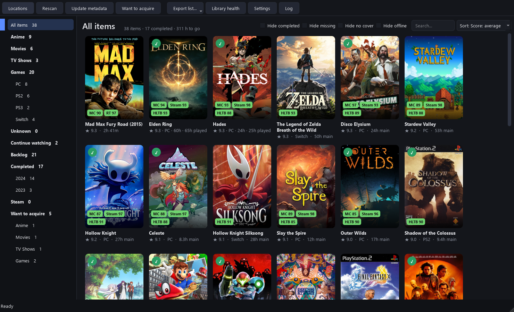
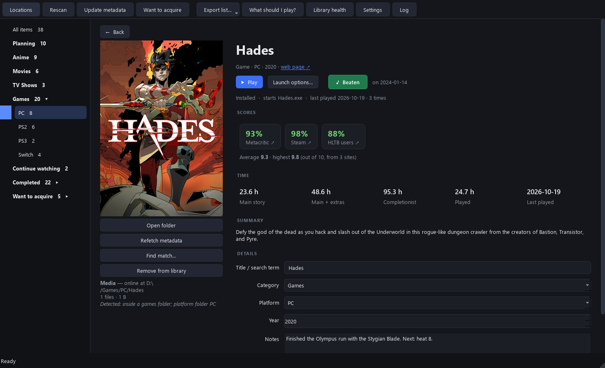
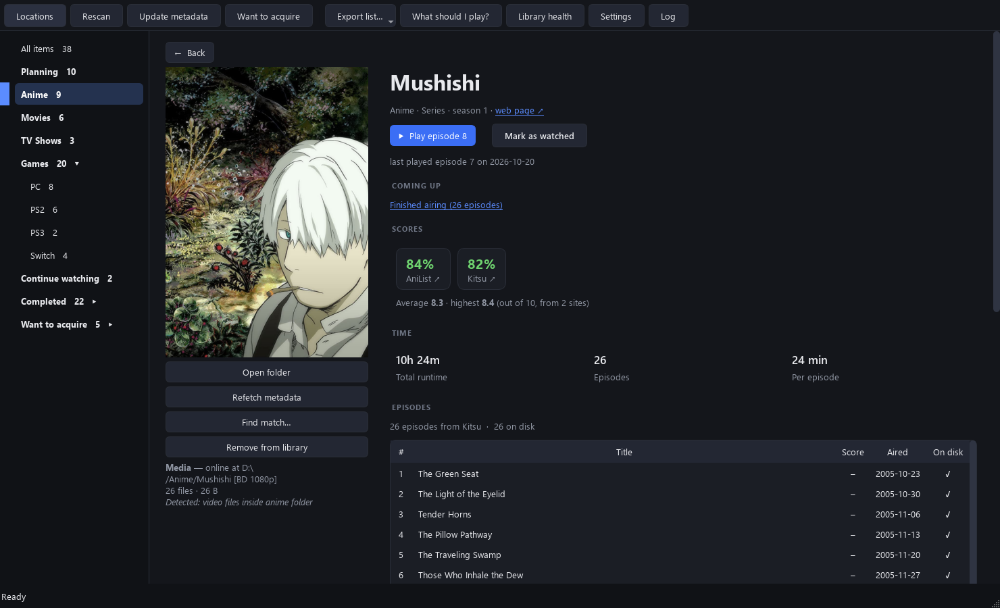
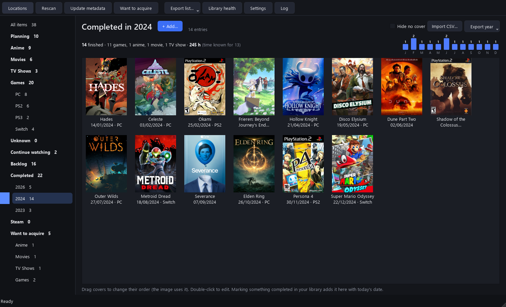
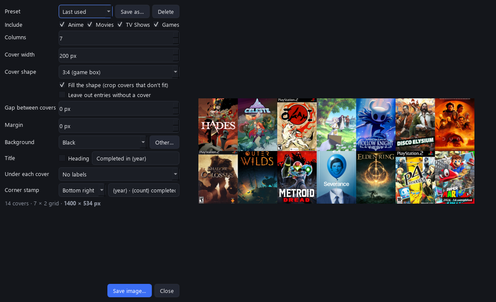
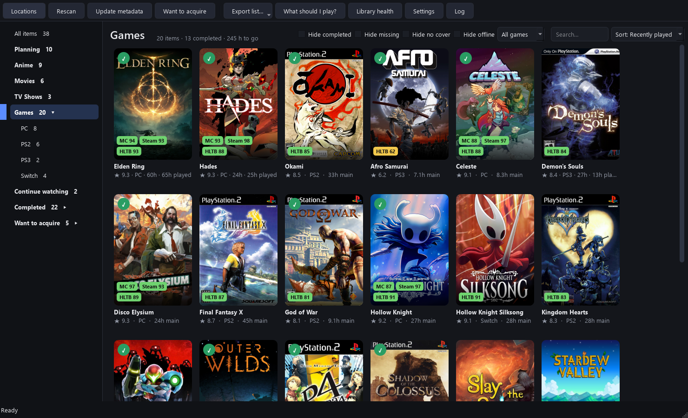
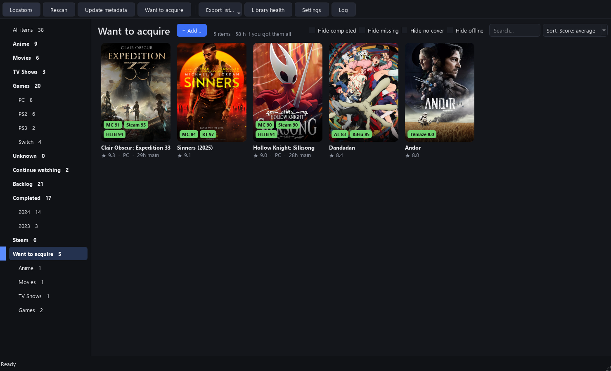
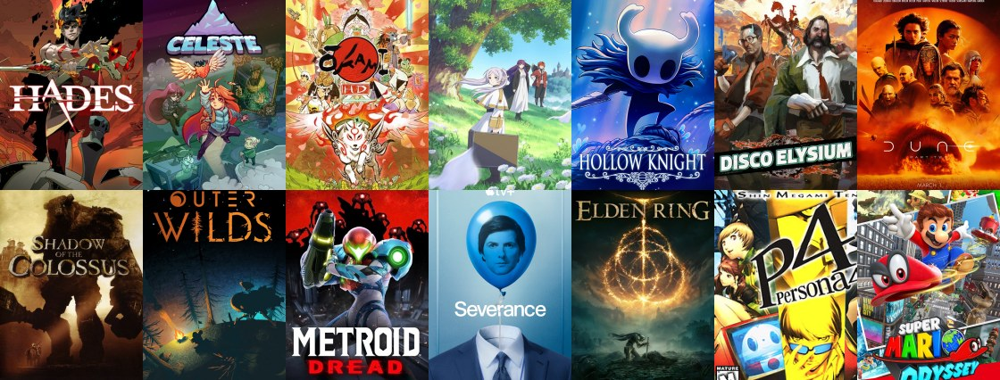

> [!IMPORTANT]
> This project was fully made with AI. I understand that not everyone wants to support/use
> software made with AI; if you fit into this group, perhaps you should look elsewhere.

<div align="center">

# Tracking

**One library for your anime, movies, TV shows and games, wherever they live.**

Point it at your drives and folders: it finds what's there, sorts it into sections,
fetches covers, scores from a dozen sites and how long everything takes, and
remembers what you've finished, even when the drive is unplugged.


-41CD52?logo=qt&logoColor=white)




</div>

## Highlights

- 🗂️ **Scans folders and whole drives** into **Anime**, **Movies**, **TV Shows** and
  **Games** (split by platform: PC, PS1–PS5, PSP, Switch, Wii, Saturn, Dreamcast…).
- ⭐ **Scores from many sites** as small chips on every cover, plus a ★ average to sort by:
  IMDb, Rotten Tomatoes, Metacritic, TMDB, AniList, MyAnimeList, AniDB, Kitsu, TVmaze,
  Trakt, OpenCritic, IGDB, Steam reviews, HowLongToBeat.
- ⏱️ **Total time** for everything: the runtime of all episodes, or HowLongToBeat hours for games.
- ✅ **Completed log by year**: mark things done, import old years from CSV, edit dates, see
  each year's stats, and **export a year as a cover-grid image**.
- 📚 **Backlog**: what you own and haven't finished, with a *Shortest first* sort for
  "what next?".
- 🩺 **Library health**: items without a cover or score, games without a platform,
  possible duplicates and missing files, each one click away from a fix.
- 🛒 **Want to acquire**: search any service and keep a wish list; it moves into your
  library by itself when a scan finds it.
- ▶️ **Play from the library**: PC games start their own .exe, console games open in the
  emulator you pick per platform (zipped discs are unpacked for you), Steam games in Steam.
  Filter games by *Installed*, *Installer* or *ROM / disc*, and sort by *Recently played*.
- 🎮 **Steam accounts**: your owned games with **time played**, in their own section.
- 🔎 **Find match**: if something found the wrong thing (or nothing), search every service
  with any name and pick the right result.
- 💽 **Reads game discs like an emulator**: PS1/PS2 serials (named via PCSX2's database),
  PSP/PS3 `PARAM.SFO`, Wii/GameCube headers, even inside `.zip` files.
- 🔌 **Drives are tracked by id, not letter**: unplug a disk and its items stay, dimmed;
  plug it in as another letter and nothing breaks.

## Screenshots

<table>
  <tr>
    <td width="50%"><br>
      <sub><b>Item page</b>: every score, HowLongToBeat times, completion, notes, edits.</sub></td>
    <td width="50%"><br>
      <sub><b>Episodes</b>: the full list with per-episode scores and which ones you have.</sub></td>
  </tr>
  <tr>
    <td><br>
      <sub><b>Completed</b>: one page per year with its stats; drag covers into your own order.</sub></td>
    <td><br>
      <sub><b>Export year as image</b>: columns, cover size and shape, gaps, background.</sub></td>
  </tr>
  <tr>
    <td><br>
      <sub><b>Games</b> split by platform, with HowLongToBeat hours on each card.</sub></td>
    <td><br>
      <sub><b>Want to acquire</b>: things you don't have yet, with covers and scores.</sub></td>
  </tr>
</table>

<details>
<summary><b>The exported image</b> (Completed › 2024 › Export year › As image)</summary>
<br>

</details>

## Getting started

```bat
run.bat        :: starts dist\Tracking\Tracking.exe (builds it first if it's missing)
build.bat      :: builds a fresh Tracking.exe and runs its self-test
```

The build (PyInstaller, via `build.ps1` and `packaging\Tracking.spec`) creates the virtual
environment on first use and bundles Python, Qt, MediaInfo and the parsing libraries into
`dist\Tracking\` (~140 MB). Zip that folder to move it to another PC; no Python needed there.

<details>
<summary>Run from source instead</summary>

```bat
python -m venv .venv
.venv\Scripts\pip install -r requirements.txt
.venv\Scripts\python -m tracking
```
</details>

On first start the **Locations** window opens. Add a whole drive or a folder, pick what it
holds (or leave *Auto-detect*), and it's scanned right away. Then:

| | |
|---|---|
| **F5** · Rescan | Pick locations; optionally mark items no longer found as completed |
| **Update metadata** | Fetch what's missing (items without a cover are retried) |
| **Ctrl+N** | Add to *Want to acquire*, or a *Completed* entry when you're there |
| **Right-click** | Move to another section / platform, complete, refetch, remove |
| **Export list…** | A spreadsheet of the items missing a cover or scores, or of what's shown |
| **Library health…** (Ctrl+H) | What needs a look, with *Show* and *Fetch again* |
| **▶ Play** | On a game's page or right-click (Ctrl+Enter in the grid). Emulators: Settings › Emulators |
| **Find match…** | On an item's page or right-click: search by hand and pick the right result |
| **Hide offline** | Hide what's on unplugged drives; drives are re-checked every 25 s |

<details>
<summary>Keyboard</summary>

| Key | |
|---|---|
| Arrows · Enter | Move around the grid · open an item |
| Space | Mark the selected items completed (again: not completed) |
| Ctrl+Enter | Play the selected game |
| Ctrl+A | Select everything shown |
| Ctrl+F · Esc | Search · clear the search |
| Esc · Alt+← | Back from an item page |
| F5 · Ctrl+N · Ctrl+L | Rescan · add (wish list / completed) · locations |
</details>

## Completed, by year

Everything you finish is logged with the day you marked it. The **Completed** section has one
page per year: drag covers to reorder, double-click to edit the name, date, section, platform
or notes, right-click to pick your own cover. Each year shows what you finished per section,
the hours it took (Steam play time or HowLongToBeat for games, runtime for the rest) and a
month-by-month chart.

**Import older years** with *Import CSV…*, one file per year or all at once:

```csv
name,date
God of War,12/01/2023
Incredible Hulk, The,05/02/2023
Hades,20/03/2023
Elden Ring,
```

- Dates are `DD/MM/YYYY` (`2023-01-12` works too). In a file named for its year (`2023.csv`)
  `DD/MM` is enough, and a line with no date is filed under that year.
- Commas or semicolons; the header is optional; a third column can hold the platform; empty
  extra columns (`Hades,20/03,,,`) are ignored.
- Names that match your library use its cover; the rest are looked up. Re-importing skips
  what's already there.

**Export year › As image…** draws the year's covers as one picture, with a live preview and
its exact size in pixels:

| Option | |
|---|---|
| Columns | Automatic (nearly square) or a fixed number |
| Cover width & shape | Default 264 px; IGDB (264×374), 3:4, 2:3 or square; crop to fill, or fit |
| Gap · Margin | In pixels |
| Background | Transparent, black, white or any colour |
| Title · labels | "Completed in 2024" on top; title and/or date under each cover |
| Corner stamp | A small "2024 · 14 completed" badge in any corner |
| Presets | Save your settings by name ("Twitter grid", "Big poster") and switch between them |
| Format | PNG or JPG |

*Export year › As CSV…* writes the same format the import reads.

## Where the data comes from

Works out of the box. Free keys (Settings, one tab per section) add more scores.

| | No key needed | With a free key |
|---|---|---|
| **Anime** | AniList, Kitsu, MyAnimeList (Jikan): scores, covers, episodes | AniDB, Trakt |
| **Movies** | IMDb posters and links | OMDb (IMDb, Rotten Tomatoes, Metacritic), TMDB, Trakt |
| **TV** | TVmaze ratings, posters, episodes; IMDb | OMDb, TMDB, Trakt |
| **Games** | HowLongToBeat (times, covers, user score), Steam reviews + Metacritic | RAWG, IGDB, OpenCritic, Steam Web API (your account) |

<details>
<summary>Where to get the keys</summary>

| Key | Gives | Get it at |
|---|---|---|
| OMDb | IMDb / Rotten Tomatoes / Metacritic | https://www.omdbapi.com/apikey.aspx |
| TMDB | TMDB score, better posters | https://www.themoviedb.org/settings/api |
| Trakt Client ID | Trakt score | https://trakt.tv/oauth/applications/new |
| AniDB client | AniDB score | https://anidb.net/software/add |
| RAWG | Metacritic, descriptions | https://rawg.io/apidocs |
| IGDB (Twitch) | Critic / user scores, covers, great for retro | https://dev.twitch.tv/console/apps |
| OpenCritic | OpenCritic score (via RapidAPI) | https://rapidapi.com |
| Steam Web API | Your owned games and time played | https://steamcommunity.com/dev/apikey |
</details>

## How your files are recognised

<details>
<summary>Sections, platforms and grouping</summary>

- Folders named *Anime / Movies / Films / TV / Games / ROMs* and platform folders
  (*PS2*, *PC Games*, *Sony - PlayStation 3*, *Nintendo 64*…) are containers; anything inside
  is one item. A folder with any name holding 3+ releases is a container too.
- Without folder hints the contents decide: ROM extensions, disc headers, `PS3_GAME`, `.exe`
  for PC, fansub-style names for anime, `S01E02` for TV.
- **Platform** of ambiguous files (`.iso`, `.chd`, `.zip`…): platform folder › ROM extension ›
  release tags (`[FitGirl Repack]`, Switch title ids, `(PS2)`) › `.exe` › disc header › words in
  the path. When the name or platform says too little, the disc itself is read (`SYSTEM.CNF`,
  `PARAM.SFO`, Nintendo headers).
- **Series**: one item per show and season; specials join season 1; episodes spread over
  folders and loose files are merged. Movies are never merged into a series.
- Collection packs are understood: `1a. OVA - Bubblegum CRASH (1991)` is *Bubblegum CRASH*,
  `14 - Owarimonogatari S2` is *Owarimonogatari Season 2*, `S01E01-Episode Title.mkv` takes the
  show's name from its folder.
- Extras (NCOP/NCED, AMVs, PVs, menus, trailers) don't count as episodes.
- Updates and DLC count under their game; two copies of a game or movie are one item.
- `Incredible Hulk, The` is looked up as *The Incredible Hulk*.

Anything it gets wrong: fix it on the item page or with right-click › Move to. Each item page
shows *why* it was detected the way it was.
</details>

<details>
<summary>Drives, offline items and moved files</summary>

- Each location is stored as (volume id, path inside it): the Windows volume GUID plus the
  filesystem serial, so the same disk is recognised on another PC; mapped drives by UNC share.
- An unplugged drive's items stay (dimmed, or with a small icon; your choice in Settings).
- Removing a location asks whether to keep its items.
- Moved files are re-linked, keeping their completed state and notes.
- Missing items are never deleted; Rescan can mark them completed instead.
</details>

## Your data

Everything lives in `%LOCALAPPDATA%\Tracking` (or `TRACKING_DATA_DIR`):

```
library.sqlite3   items, scores, completions, notes, locations
posters\          cover art, one file per item
cache\            cached service answers (keeps within rate limits)
logs\             tracking.log (level in Settings › General)
```

- **Portable mode**: create a `data` folder next to `Tracking.exe` and the library lives there.
- **Export / import** (Settings › General): one `.zip`, database only or with covers; API keys
  are left out unless you ask. Import replaces your library or merges into it (your edits win).
- A `cover.jpg` / `folder.jpg` / `poster.jpg` in an item's folder is used as its cover.

## What's next

Tracking is heading towards being **the launcher for everything outside Steam**: telling
installed games from installers, launching PC games and emulators, playing episodes with
"continue watching", moving games between drives while the library follows, and more. See
the [wishlist](docs/WISHLIST.md).

## For developers

- Code layout, and how to add a service, section or platform: [docs/ARCHITECTURE.md](docs/ARCHITECTURE.md)
- Tests: `.venv\Scripts\pip install pytest`, then `.venv\Scripts\python -m pytest`
